

  

<h1 align="center">Nicolás Morales</h1>

<h3 align="center">
  Analista Programador · Ingeniero de Ejecución en Computación e Informática 
  Chile 🇨🇱 · <!--anos-->7<!--/anos--> años de experiencia (desde 2019)
</h3>

  

  

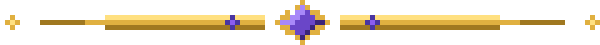

## 🧙 Sobre mí

Desarrollo soluciones tecnológicas reales en industrias exigentes. Me he enfocado no sólo en programar, sino en seguir aprendiendo habilidades que me permitan crecer profesional y personalmente: las mejores soluciones surgen cuando combinamos visión técnica con necesidades reales del negocio.

- 🏗️ **Industrias:** construcción, agroindustria (viñas y riego), salud y farmacias, comercio y pymes, sostenibilidad (ESG) y facturación electrónica
- 🧰 **Áreas:** desarrollo fullstack, infraestructura, automatización e integración de plataformas

## ⚔️ Arsenal

<table>
  <tr>
    <td><b>Programación</b></td>
    <td>
      <a href="https://developer.mozilla.org/es/docs/Web/JavaScript">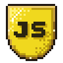</a>
      <a href="https://nodejs.org/">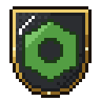</a>
      <a href="https://www.typescriptlang.org/">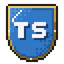</a>
      <a href="https://react.dev/">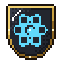</a>
      <a href="https://www.python.org/">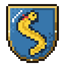</a>
      <a href="https://www.php.net/">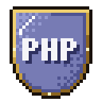</a>
      <a href="https://dotnet.microsoft.com/apps/aspnet">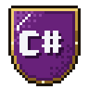</a>
      <a href="https://nestjs.com/">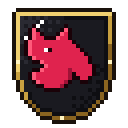</a>
      <a href="https://go.dev/">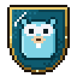</a>
    </td>
  </tr>
  <tr>
    <td><b>UX/UI</b></td>
    <td>
      <a href="https://bulma.io/">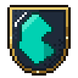</a>
      
      
    </td>
  </tr>
  <tr>
    <td><b>Bases de datos</b></td>
    <td>
      
      <a href="https://www.mongodb.com/">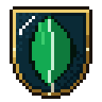</a>
      <a href="https://mariadb.org/">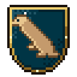</a>
    </td>
  </tr>
  <tr>
    <td><b>Infraestructura</b></td>
    <td>
      <a href="https://www.docker.com/">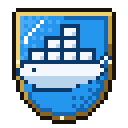</a>
    </td>
  </tr>
</table>

Pasa el mouse sobre un escudo para ver su nombre; haz clic para ir a su sitio oficial.
